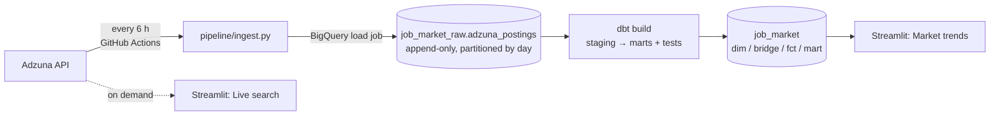

# Job Posting Monitor

An end-to-end analytics pipeline that tracks data analyst, data scientist and analytics engineer job postings in the San Francisco Bay Area. Every 6 hours it collects postings from the Adzuna API, loads them into BigQuery, models and tests them with dbt, and serves the results in a Streamlit dashboard.

**Live app:** https://job-posting-monitor.streamlit.app/

## Why

Job boards show you today's list. They don't tell you how many new roles appear each week, which companies keep hiring, what skills each role asks for, or how much of the advertised pay is real. Answering that needs history, so this project stores a snapshot every 6 hours and builds the trends from those snapshots.

## Architecture



| Layer | Tool | What it does |
|---|---|---|
| Extract + load | Python, [`pipeline/ingest.py`](pipeline/ingest.py) | Calls Adzuna for each search in [`searches.yml`](pipeline/searches.yml) and appends one snapshot per run to the raw table. |
| Orchestration | GitHub Actions, [`pipeline.yml`](.github/workflows/pipeline.yml) | Runs ingest + `dbt build` at 00:17, 06:17, 12:17 and 18:17 UTC. |
| Warehouse | BigQuery, or DuckDB locally | The same dbt project runs on both. |
| Transform + test | dbt 2.0, [`job_market/`](job_market/) | Cleans, deduplicates and models the snapshots, with 19 data tests. |
| Serve | Streamlit, [`app.py`](app.py) | Market trends tab (BigQuery) and a Live search tab (Adzuna). |

## Data model

| Model | Grain | Purpose |
|---|---|---|
| `stg_adzuna__postings` (view) | posting × search × run | Typed and renamed, with Adzuna's `<strong>` highlight tags stripped. |
| `dim_postings` | one row per posting | Latest attributes, plus `first_seen_at`, `last_seen_at`, `times_seen` and `posted_salary_mid`. |
| `bridge_posting_roles` | posting × role | A "Data Analyst / Data Scientist" posting belongs to both roles without being double-counted in `dim_postings`. |
| `fct_daily_postings` | posted date × role | New postings per day and the average *posted* salary. |
| `mart_skill_mentions` | skill × role | Share of postings that mention each skill in [`seeds/skills.csv`](job_market/seeds/skills.csv) (regex matches). |

Tests cover not-null and unique keys, relationships (bridge → dim, mentions → skills seed), one row per posting × role, and a salary-range check. The salary check is set to `warn`, because a bad range is the employer's data, not a pipeline bug.

## Design decisions

- **Raw stays raw (ELT).** Each run appends a full snapshot and nothing is updated in place. Deduplication and "latest version" logic live in dbt, where they're tested and can be rebuilt from history.
- **Exact-phrase search.** Adzuna's default keyword search matches any word, so "people analytics" returned "Event Manager". The pipeline uses `what_phrase`. The Live search tab lets you compare exact phrase, all words and any word.
- **Load jobs, not streaming inserts.** Load jobs are free and work in the BigQuery sandbox; streaming inserts don't.
- **A rolling 60-day history on the free tier.** Sandbox tables expire after 60 days. The raw table is partitioned by day with a 60-day partition expiry, and each run pushes the table's own expiry forward. Old days age out one at a time instead of the whole table disappearing at once.
- **One dbt project, two warehouses.** The two SQL differences between DuckDB and BigQuery (regex replace and regex match) are wrapped in [`macros/cross_db.sql`](job_market/macros/cross_db.sql) with `adapter.dispatch`. The source switches between local Parquet files and the BigQuery table based on the target, so `dbt build` runs locally and `dbt build --target bigquery` runs in CI.
- **Posted vs. estimated salary.** About 60% of Adzuna salaries are Adzuna's own estimates (`salary_is_predicted`). Salary metrics use employer-posted ranges only.
- **Secrets stay server-side.** API keys live in GitHub and Streamlit secrets and never reach the browser. Error messages leave out request URLs, because those contain the API key. The public app uses a separate read-only service account.
- **API-quota aware.** The pipeline uses 12 Adzuna calls a day. Live search calls the API only when someone presses Search, so page views cost nothing.

## Limitations

- **Skill shares are a lower bound.** The Adzuna search API returns only about the first 500 characters of each description, which is often the company intro. Trends over time are more meaningful than the absolute percentages.
- **Coverage is the newest 50 postings per role per run.** In a busy 6-hour window, some postings may never be seen. Raise `max_pages` in `searches.yml` to collect more; each page costs one API call.
- **`last_seen_at` doesn't mean "taken down".** A posting stops appearing once newer ones push it off the first page.
- **Location is "San Francisco + 80 km".** That's an approximation of the Bay Area, and remote roles listed elsewhere are not included.
- **History is limited to 60 days** while the project runs on the BigQuery sandbox.

## Run it locally

Requires Python 3.10+ and an [Adzuna API key](https://developer.adzuna.com/).

```bash
python3 -m venv .venv && source .venv/bin/activate
pip install -r requirements.txt -r pipeline/requirements.txt

export ADZUNA_APP_ID=your_id ADZUNA_APP_KEY=your_key
./pipeline/run.sh          # ingest to data/raw/*.parquet, then dbt build on DuckDB
streamlit run app.py       # Market trends reads data/job_market.duckdb
```

To run against BigQuery instead, set `BQ_PROJECT` and `GOOGLE_APPLICATION_CREDENTIALS` (a service account key file), then:

```bash
python pipeline/ingest.py --bigquery
cd job_market && dbt build --target bigquery
```

## Deploy your own

1. **Google Cloud:** create two service accounts.
   - Pipeline: BigQuery Data Editor, BigQuery Job User and BigQuery Read Session User (dbt 2.0 reads results through the Storage Read API).
   - App: BigQuery Data Viewer and BigQuery Job User.
2. **GitHub repository secrets:** `ADZUNA_APP_ID`, `ADZUNA_APP_KEY`, `BQ_PROJECT`, and `GCP_SA_KEY` (the pipeline key's JSON). Then run the **pipeline** workflow once from the Actions tab.
3. **Streamlit Community Cloud secrets:** `ADZUNA_APP_ID`, `ADZUNA_APP_KEY`, `BQ_PROJECT`, and `GCP_SA_KEY` (the app key's JSON, wrapped in `'''` triple quotes).

## Repository layout

```
app.py                     Streamlit app (Market trends + Live search)
pipeline/
  searches.yml             roles, location, pages per run
  ingest.py                Adzuna → Parquet (local) or BigQuery (--bigquery)
  run.sh                   local run: ingest + dbt build
job_market/                dbt project
  models/staging/          source + stg_adzuna__postings
  models/marts/            dim_postings, bridge_posting_roles, fct_daily_postings, mart_skill_mentions
  macros/cross_db.sql      DuckDB / BigQuery SQL differences
  seeds/skills.csv         skills and their regex patterns
  tests/                   singular data tests
.github/workflows/         scheduled pipeline
```
